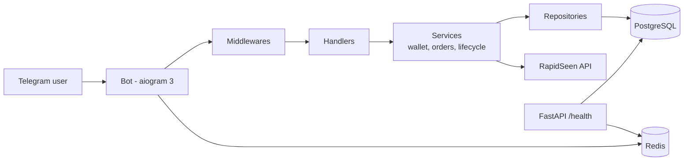

<h1 align="center">Telegram Services Platform</h1>

<p align="center">
An async Telegram bot with a wallet, order management and an external SMM API (RapidSeen), running next to a small FastAPI service — built in phases.
</p>

<p align="center">
  
  
  
  
  
  
  
</p>

Users talk to a Telegram bot in Persian or English. Every user gets a **wallet of coins**; services (for example post views) are bought with coins, each purchase becomes an **order** with a tracking code, and the order is fulfilled through the **RapidSeen SMM API**. The project is split into phases — infrastructure, wallet and order engine, and the user-facing ordering flows — and the decisions taken in each phase are written down in `docs/`.

> **Status.** Phases 1 and 2 are implemented. Phase 3 (the ordering flows in the bot) is a **draft**: the code is in the repository but not yet connected to the running bot. [`docs/known-issues-and-roadmap.md`](docs/known-issues-and-roadmap.md) lists exactly what is missing.

---

## Features

| Area | What is there |
|---|---|
| **Bot** | `/start`, main menu, profile, settings, help, bilingual (fa / en) with language switching, automatic user registration on the first message |
| **Forced channel join** | Middleware that checks membership of required channels (implemented, currently not enabled in `app/main.py`) |
| **Wallet** | Coin balance per user, atomic `credit` / `debit`, transaction history (`CREDIT`, `DEBIT`, `REFUND`, `ADJUSTMENT`), `InsufficientBalanceError` |
| **Orders** | Internal orders with a tracking code (`ORD-XXXXXXXX`), idempotency key against double submission, snapshot of price and service at order time |
| **RapidSeen client** | `add_order`, `get_status`, `cancel_order` over `httpx`, typed with Pydantic schemas |
| **Order lifecycle** | Status polling and mapping to internal states, cancel *requests*, proportional refund for `PARTIAL` / `CANCELED` orders with double-refund protection |
| **Web service** | FastAPI with `/health`, `/health/liveness`, `/health/readiness` (checks PostgreSQL and Redis) |
| **Operations** | Concurrent runner for bot + web server with graceful shutdown, logging setup, Alembic async migrations, Docker Compose for PostgreSQL and Redis |
| **Phase 3 (draft)** | Ordering flows for single and multi-post views with a state machine (quantity → speed → link → confirmation), link validation, order tracking, main keyboard |

## Architecture



Handlers call **services** (business rules), which call **repositories** (SQL). Details, the data model and the order flow: [`docs/architecture.md`](docs/architecture.md).

## Tech stack

Python 3.12 · aiogram 3 · FastAPI + Uvicorn · SQLAlchemy 2 (async) + asyncpg · Alembic · PostgreSQL 16 · Redis 7 · httpx · Pydantic Settings · pytest + pytest-asyncio · Docker Compose

## Quick start

```bash
git clone https://github.com/ftharir/telegram-services-platform.git
cd telegram-services-platform
python -m venv .venv && source .venv/bin/activate     # Windows: .venv\Scripts\activate
pip install -r requirements.txt

cp .env.example .env            # then set BOT_TOKEN and the database password
docker compose up -d            # PostgreSQL (port 5434) and Redis (6379)
alembic upgrade head            # create the tables
python -m app.run               # bot + web server
```

Full instructions, every setting and the health-check URLs: [`docs/getting-started.md`](docs/getting-started.md).

## Order flow in one minute

1. The user buys a service; the **cost is debited** from the wallet.
2. An **internal order** is created (`PENDING`) with a tracking code and an idempotency key.
3. The order is sent to RapidSeen. On an API error the coins are **refunded** and the order becomes `FAILED`.
4. A status check maps the provider's status to `SUBMITTED`, `IN_PROGRESS`, `COMPLETED`, `PARTIAL` or `CANCELED`.
5. For `PARTIAL` / `CANCELED` orders the user gets back `cost × remains ÷ original quantity` coins (rounded half-up), once.

The rules and the assumptions behind them (rounding, what a cancel request means, what to do when `remains` is missing) are recorded in [`docs/phase2-decisions.md`](docs/phase2-decisions.md).

## Project structure

```
telegram-services-platform/
├── app/
│   ├── run.py                   bot + web server together, graceful shutdown
│   ├── main.py                  bot setup (dispatcher, middlewares, routers)
│   ├── web.py                   FastAPI application
│   ├── api/                     health endpoints
│   ├── bot/
│   │   ├── handlers/            start, account, phase 3 flows (draft)
│   │   ├── keyboards/ states/   inline and reply keyboards, FSM states
│   │   └── middlewares/         DB session + user registration, forced channel join
│   ├── core/                    settings, logging, enums, locales, shutdown
│   ├── database/                models, repositories, session
│   ├── integrations/rapidseen/  API client and schemas
│   ├── services/                wallet, order, placement, lifecycle, user
│   └── redis_client/
├── alembic/                     migrations: users, wallets, transactions, orders
├── docs/                        architecture, getting started, decisions, known issues
├── tests/  scripts/             pytest tests and a manual API script
├── docker-compose.yml  .env.example  pyproject.toml  requirements.txt
└── test_phase2_suite.py         mock-based Phase 2 suite
```

## Tests

```bash
python test_phase2_suite.py     # no database needed - wallet, refunds, status mapping, tracking code
pytest                          # tests/ - some need the PostgreSQL container running
```

`test_phase2_suite.py` passes (5 of 5 checks). Part of `tests/` currently fails at import because of one missing exception class; this and the other open points are listed in [`docs/known-issues-and-roadmap.md`](docs/known-issues-and-roadmap.md).

## Documentation

| Document | Content |
|---|---|
| [`docs/getting-started.md`](docs/getting-started.md) | Install, configure, run, tests |
| [`docs/architecture.md`](docs/architecture.md) | Layers, data model, order flow |
| [`docs/phase2-decisions.md`](docs/phase2-decisions.md) | Refund rule, rounding, cancel semantics |
| [`docs/phase3-decisions.md`](docs/phase3-decisions.md) | Service-id fallback for view orders |
| [`docs/known-issues-and-roadmap.md`](docs/known-issues-and-roadmap.md) | What is incomplete, and the plan |

## Security notes

* Secrets live only in `.env` (ignored by git); `.env.example` has placeholders.
* The compose file contains a development-only database password; change it before any shared use.
* Never paste project dumps that include `.env` into chats or issues.

## خلاصه به فارسی

بستر ارائه‌دهنده خدمات تلگرام با معماری لایه‌ای (هندلر ← سرویس ← ریپازیتوری):

- **فاز ۱:** پایه دیتابیس و زیرساخت، ربات دو‌زبانه (فارسی/انگلیسی)، عضویت اجباری کانال، سلامت‌سنجی (`/health`).
- **فاز ۲:** کیف‌پول (کسر و افزایش اتمیک سکه)، ثبت سفارش با کد پیگیری و کلید جلوگیری از ثبت تکراری، اتصال به RapidSeen API، چرخه عمر سفارش و مرجوعی متناسب برای سفارش‌های ناقص یا لغوشده.
- **فاز ۳ (پیش‌نویس):** جریان ثبت بازدید تک‌پستی و چندپستی، اعتبارسنجی لینک و پیگیری سفارش. هنوز به ربات در حال اجرا وصل نشده است.

نصب و اجرا: بخش **Quick start** بالا. موارد ناقص و برنامه ادامه‌ی کار: [`docs/known-issues-and-roadmap.md`](docs/known-issues-and-roadmap.md).

## License

MIT — see [`LICENSE`](LICENSE).
