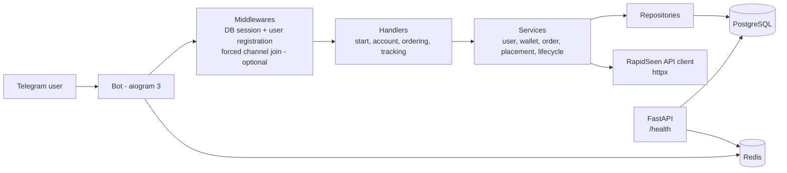
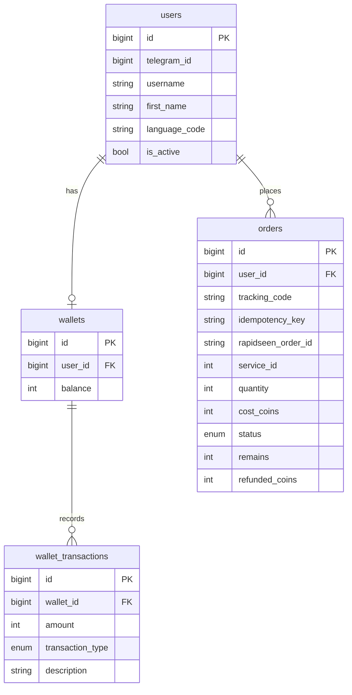

# Architecture

The platform is one Python process that runs two things side by side: the **Telegram bot** (aiogram 3, long polling) and a small **FastAPI** web server (health checks). Both share the same PostgreSQL and Redis connections and are started and stopped together by `app/run.py`.

## Layers

| Layer | Folder | Responsibility |
|---|---|---|
| Entry points | `app/run.py`, `app/main.py`, `app/web.py` | start the bot and the web server together, graceful shutdown |
| Bot | `app/bot/` | handlers, keyboards, FSM states, middlewares |
| Services | `app/services/` | business rules: wallet, orders, placement, lifecycle |
| Repositories | `app/database/repositories/` | all SQL access (SQLAlchemy 2 async) |
| Models | `app/database/models/` | `users`, `wallets`, `wallet_transactions`, `orders` |
| Integrations | `app/integrations/rapidseen/` | HTTP client and Pydantic schemas of the RapidSeen SMM API v2 |
| Core | `app/core/` | settings, logging, enums, locales (fa/en), shutdown hooks |
| Infrastructure | `docker-compose.yml`, `alembic/` | PostgreSQL 16 and Redis 7 containers, async migrations |

## Data model

`transaction_type` is one of `CREDIT`, `DEBIT`, `REFUND`, `ADJUSTMENT`; `status` is one of `PENDING`, `SUBMITTED`, `IN_PROGRESS`, `COMPLETED`, `PARTIAL`, `CANCELED`, `FAILED`. Timestamps (`created_at`, `updated_at`) are omitted from the diagram.

## Order flow (Phase 2)

1. **Placement** (`OrderPlacementService.place_order`): the cost is debited from the wallet, an internal order with a tracking code and an idempotency key is created, and the order is sent to RapidSeen. If the API call fails, the debit is refunded and the order is marked `FAILED`.
2. **Lifecycle** (`OrderLifecycleService.process_open_orders`): open orders are polled; the external status is mapped to the internal `OrderStatus`.
3. **Refund**: for `PARTIAL` and `CANCELED` orders the refund is proportional, `refund = cost * remains / original_quantity`, rounded half-up to whole coins; a refund is made only once (double-refund protection) and only when `remains` is known.
4. **Cancel**: `request_cancel` only *requests* the cancellation; the final status comes from the next status poll.

The business rules and the assumptions behind them are logged in [`phase2-decisions.md`](phase2-decisions.md) and [`phase3-decisions.md`](phase3-decisions.md).
